> 在线阅读（GitHub Pages）：https://maynor996.github.io/google-genie-4-jiedu/

# 骑龙、改天气、还能实时唠嗑：Google Genie 4 发布，世界模型离真正能玩还有多远？

做 AI 出海和互动产品的朋友，如果只盯着“文生视频”卷画质，可能会漏掉更大的风口——世界模型。最近 Google 正式发布了世界模型 Genie 4，距离去年 8 月 6 日 Genie 3 发布（当天恰逢 OpenAI 发开源模型 gpt-oss）刚好过去约 14 个月。为什么必须盯紧它？因为它不再是帮你“拍一段看完了事的片子”，而是“实时算出一整个能进去折腾的虚拟空间”。

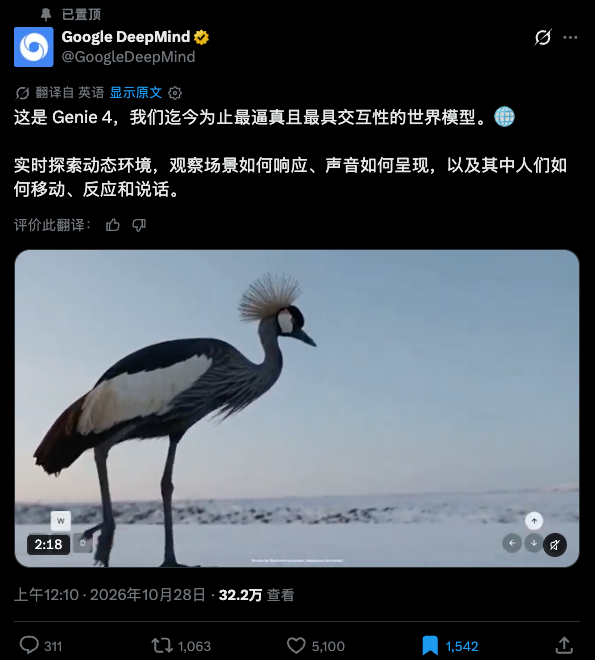
*图：Google Genie 4 官方发布图*

## 一句话看懂 Genie 4

平时用的 Seedance、可灵等工具干的活叫“拍录像”，导出后画面就焊死了，没法让主角往左迈一步。

而 Genie 4 干的是“实时演算一个能响应动作的世界”。官方演示里，你第一人称骑黑龙穿梭在群山城堡间，耳边有扑腾声、风声和火山音效。画面左下角是 WASD 键，右下角是方向箭头，画面里大部分变化都由你实时按键操控。推开门要有合理空间，碰倒的东西溜达一圈回来还得躺在地上——这就是世界模型和普通视频生成最本质的区别。

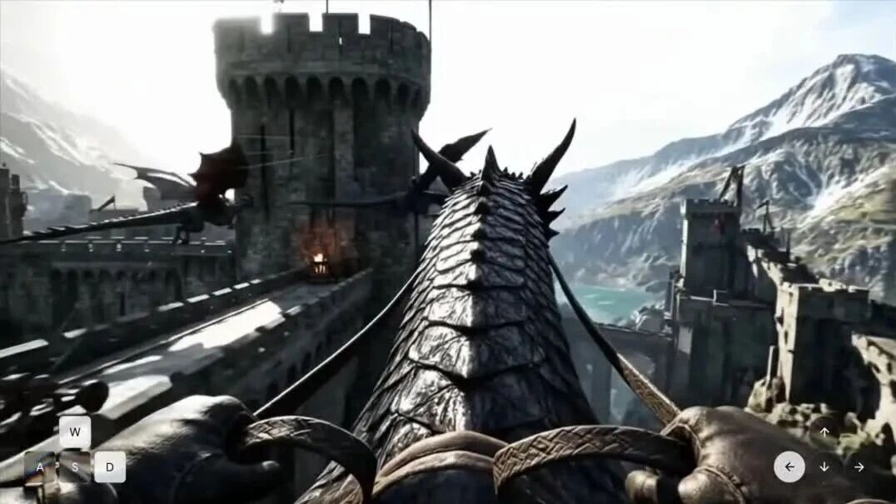
*第一人称骑龙实时操控演示（视频截图，完整演示见原文）*

## 比 Genie 3 强在哪

熬了 14 个月，Genie 4 的核心升级总结为三大块：

- **画质逼近照片级，物理规律不再“鬼畜”**：画质更接近真实照片，动作顺滑自然。对碰撞、空气动力学等物理效果的模拟上了一个大台阶，不再是软绵绵的纸片人质感。

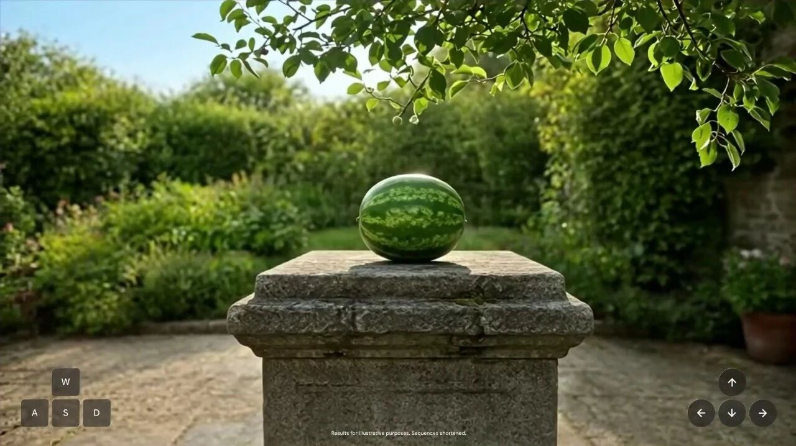
*照片级画质与物理模拟展示（视频截图，完整演示见原文）*

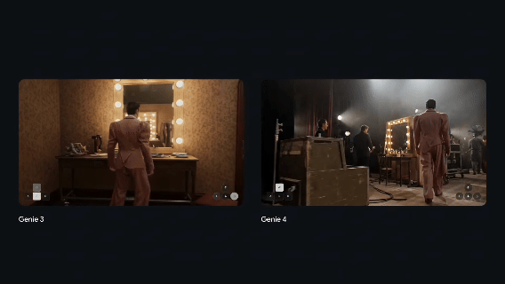
*图：Genie 4 碰撞与空气动力学等物理效果演示*

- **指哪打哪的实时控制，边玩边用嘴“改世界”**：世界一致性稳了不少。除键盘控制移动和视角外，你还能在运行中直接打字下指令——比如突然改天气、凭空加物体或改事件，它都能低延迟接住，不用重新加载。

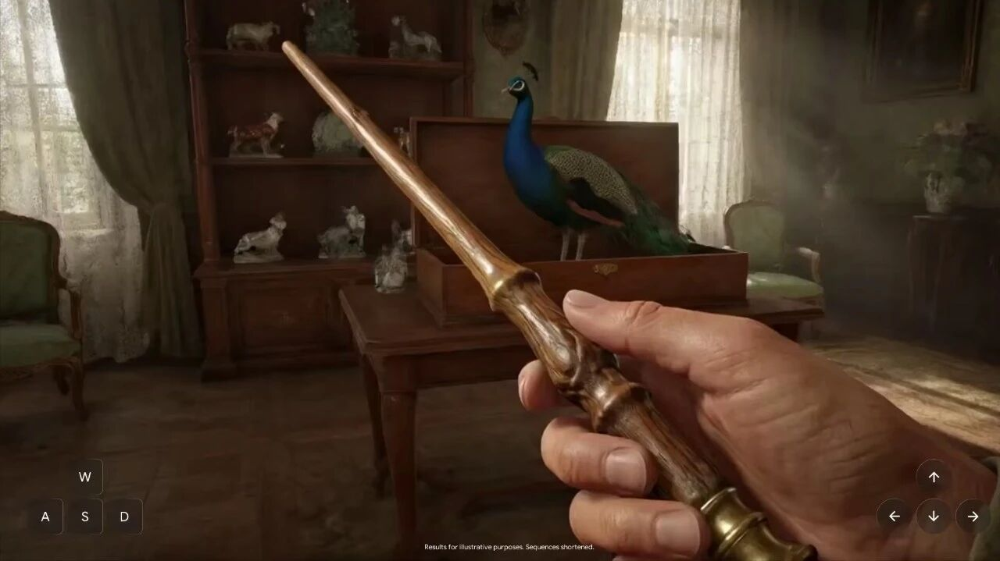
*键盘控制与高一致性表现（视频截图，完整演示见原文）*

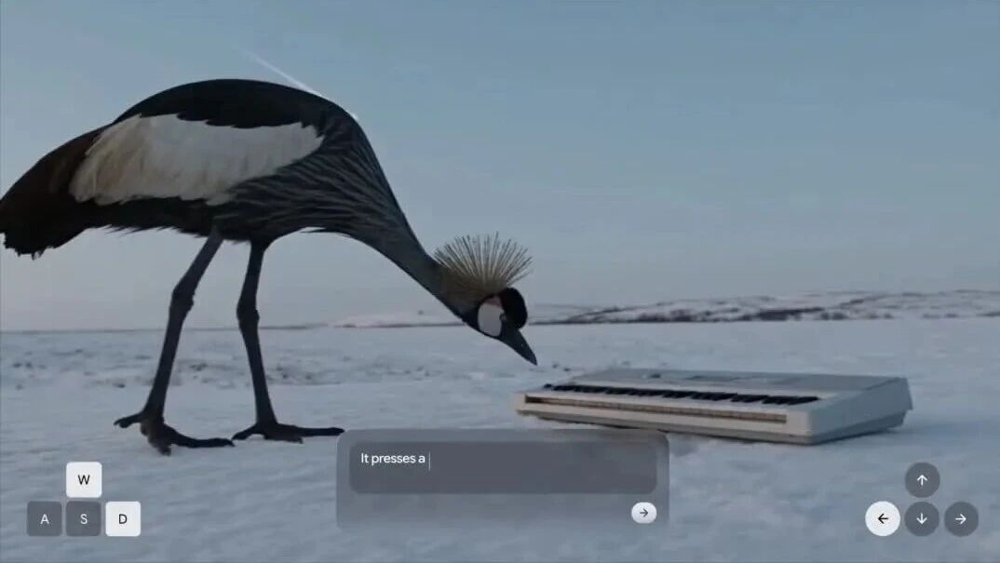
*运行中通过自然语言低延迟改世界（视频截图，完整演示见原文）*

- **告别“哑巴世界”，自带原生音频与实时对话**：这次把原生音频打包进去了，能同步生成环境音、带音乐感的背景声和角色对话。里面的 NPC 不仅能实时开口说话，还会根据周围突发事件当场做出反应。

*同步生成环境音、音乐与交互对话（视频截图，完整演示见原文）*

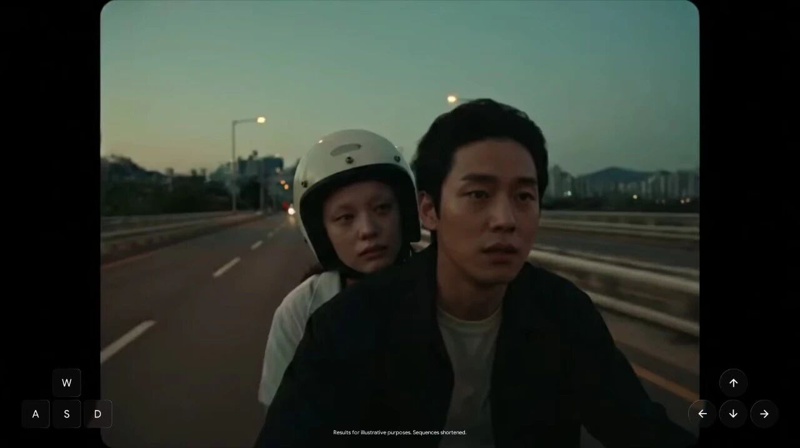
*角色实时说话并对突发事件反应（视频截图，完整演示见原文）*

## 世界模型的两条路：边画边玩 vs 先搭好再逛

现在行业搞世界模型分成了两大门派：

**第一条路叫“边画边玩”（视频生成式路线）**，代表是 Google Genie 系列。它不提前建 3D 模型，而是根据历史画面加此刻按键操作，逐帧去“猜”并画出下一秒。好处是极灵活、动态感拉满；但死穴是一致性难维持（转个身 NPC 衣服可能变色），且只要待在里面就得一直烧算力，所以公开演示很少见到连续跑 10 分钟以上的长视频。

**第二条路叫“先搭好再逛”（3D / 高斯泼溅路线）**，代表是李飞飞创办的 World Labs。他们去年 11 月上线的 Marble 采用 3D 高斯泼溅技术，无论喂文字、照片、视频还是粗糙方块布局，都能生成由约两百万个高斯点组成的完整 3D 世界。

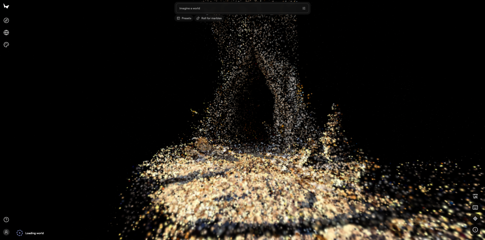
*图：Marble 未渲染完成状态*

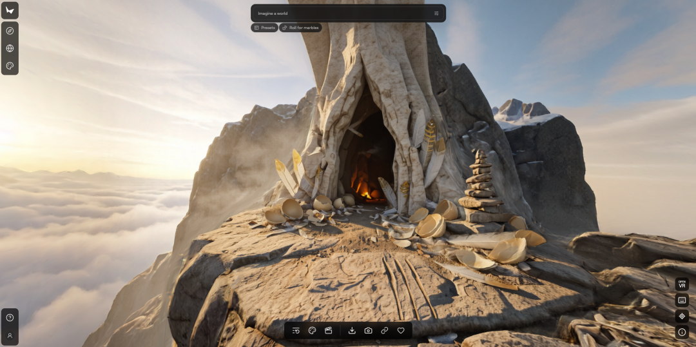
*图：约两百万个高斯点组成的 Marble 完整 3D 世界*

这门派很招工程派喜欢：世界真实搭出来，怎么转都不穿帮；渲染便宜，还能直接导出高斯泼溅或网格模型，一键塞进 Unity、UE、Blender 修改，或戴 VR 头显直接逛。缺点是纯静态，没有活蹦乱跳的角色，动画特效得进游戏引擎手搓。

拉个表看清两条路线的脾气：

| 对比维度 | 视频生成路线（如 Google Genie 4） | 3D / 高斯泼溅路线（如 World Labs Marble） |
| :--- | :--- | :--- |
| **底层逻辑** | 根据历史画面+操作，逐帧预测下一画面 | 直接生成由高斯点构成的完整 3D 空间 |
| **核心优势** | 动态强、随时可变、支持实时物理与交互 | 空间绝对一致、渲染便宜、可导出接入 Unity/UE/Blender/VR |
| **当前短板** | 长时间一致性难维持、持续消耗高额推理算力 | 场景纯静态、角色不会动、动画特效需进引擎后制 |

## 合流：Atlas 和 "Gemini 当导演"

有意思的是，两大门派现在开始互相抄作业、往一处合流了。

先看李飞飞的 World Labs，今年 9 月 1 日发布了“全能世界模型” Atlas。演示里只用三部三脚架手机拍摄，就做出了《黑客帝国》“子弹时间”那种任意新视角重渲染效果。Atlas 靠的是自研的多模态扩散模型，把空间和时间联合建模，能生成最长 1 分钟、带严格相机位姿约束的 1440p 视频，还能直接吐出点云和 3D 高斯泼溅数据，未来将驱动新版 Marble。

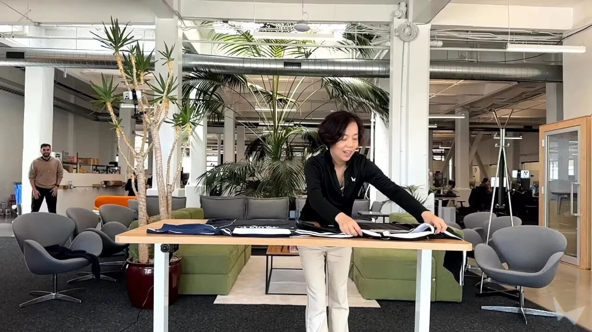
*Atlas 用三部手机实现任意新视角重渲染（视频截图，完整演示见原文）*

再看 Google，既然纯视频生成在“长因果能力”上容易迷糊，干脆请自家的 Gemini 当“场外导演”。比如接入 Gemini 3.8 Flash 作为引导智能体，把大目标拆成小步骤，逐帧检查进度；用户中途插手或环境变了，就当场重写计划。

官方还秀了 Gemini 4 Argon 和 Genie 4 搭档，模拟 Apptronik 的 Apollo 人形机器人下跳棋：Gemini 当大脑负责理解局势和规划步骤；Genie 4 当躯干负责把画面、声音和动态结果呈现出来。

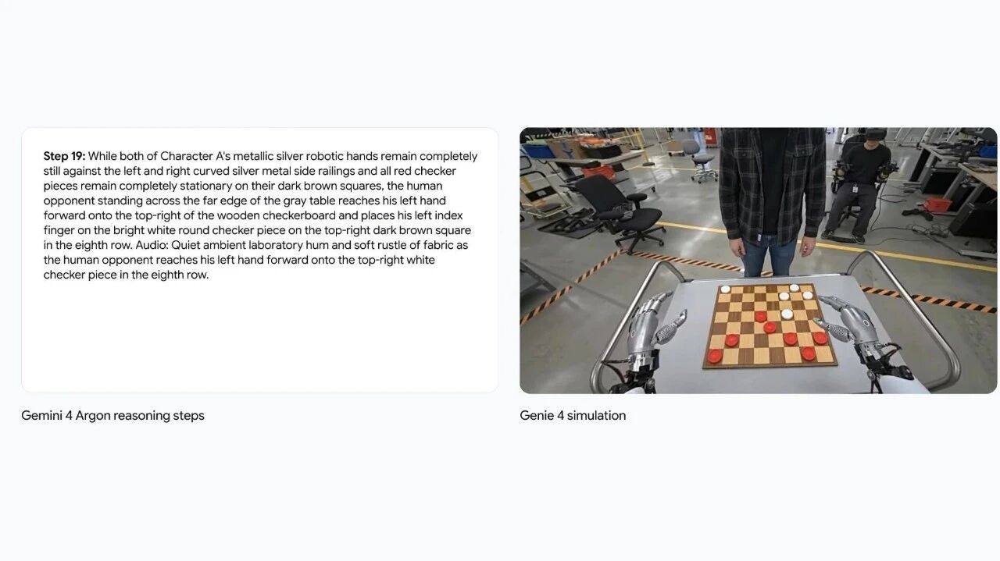
*Gemini 4 Argon 与 Genie 4 协同模拟机器人下跳棋（视频截图，完整演示见原文）*

## 对做游戏 / 互动内容的人意味着什么

传统 3A 开放世界动辄开发数年、烧数亿美元做资产，但玩家对自由度的渴望永远超过预设内容；而爆火的“互动影游”分支一多拍摄成本就爆炸。如果用上世界模型，未来游戏和影游不再是读取死板的预制任务或拍死的片子，而是顺着底层规则实时生成任务与突发事件，交付“一个会自己持续发生故事的世界”，让观众变成共创者。

但这不意味着策划要失业。纯靠 AI 随机生成玩两下就会空洞，像《塞尔达》或《博德之门3》封神靠的是底层机制精妙。正如近 20 年老玩家卡兹克说的：“规则才是王道”。技术能省下堆美术的苦力活，但定好玩的规则依然得靠人。

## 对普通用户意味着什么

对普通玩家来说，这东西最迷人的是极致沉浸感，正如资深 VR 玩家卡兹克说：“世界模型……就像我们能控制的一场清明梦”。在里面想飞就飞、想下雨就下雨，整个世界围着你的念头实时转并给出逼真的视听物理反馈，算得上人类娱乐的终极幻想之一。

## 我的看法和几个冷静点的保留意见

作为实战派博主，最后泼点冷水，保留几点清醒意见：

1. **普通人现在根本用不上**：官方压根没提何时开放、怎么收费和调用，目前还处于秀肌肉阶段。
2. **算力账单估计是天文数字**：逐帧实时响应极其烧算力，连跑 10 分钟以上的演示都少见，真让上万玩家挂机几小时成本谁也扛不住。
3. **“官方演示”不等于“落地产品”**：Demo 往往挑最好的片段，复杂长流程下空间逻辑和一致性能不能稳住还得打问号。
4. **别迷信技术能包办一切**：哪怕以后技术白菜价了，好世界的核心依然在“规则设计”和叙事节奏上，这仍是最稀缺的手艺。

咱们保持关注、提前构思玩法就行，真金白银的投入不妨等它跑通商业闭环再动手！

本文部分信息与配图参考自公众号「数字生命卡兹克」文章《Google的世界模型Genie 4正式发布，这一次，世界终于要活过来了。》，原文：https://mp.weixin.qq.com/s/f9NSNDchorq7YgSdx9_TqA，已获授权。

---

常用入口（纯文本，可复制）：

- 模型试用：http://trymodel.chat/
- API 聚合：https://tryallapi.com/
- 账号充值：https://chongzhi.chatgpt-plus.top/
